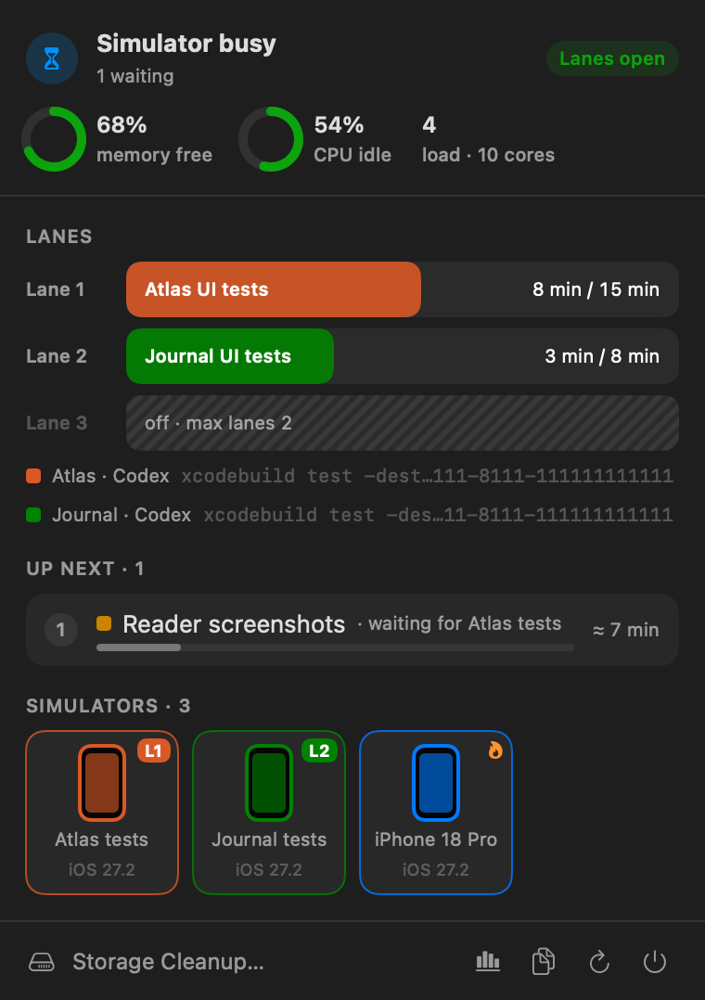
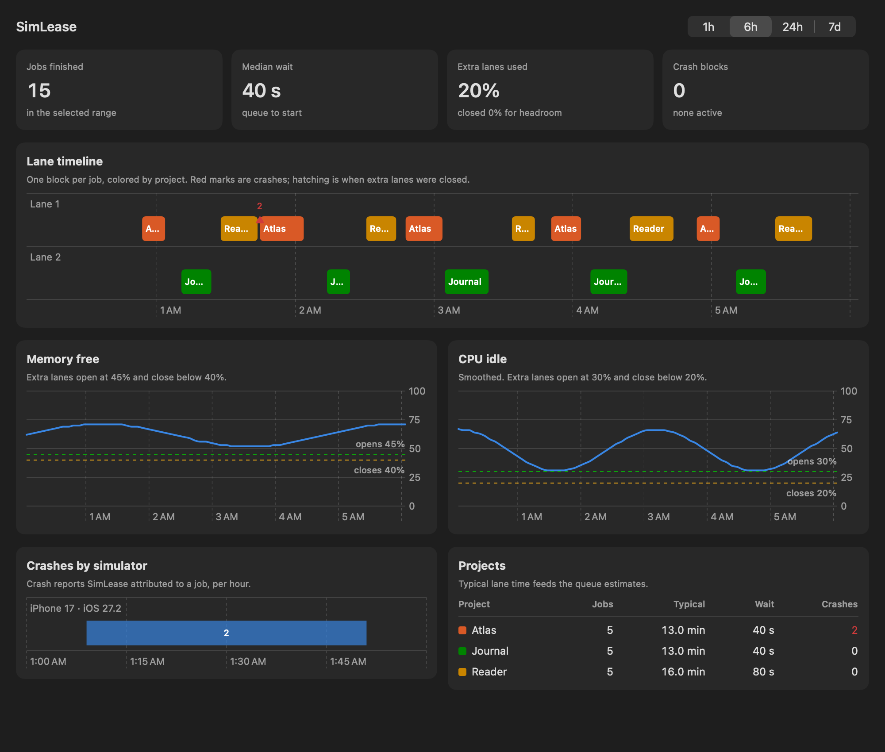
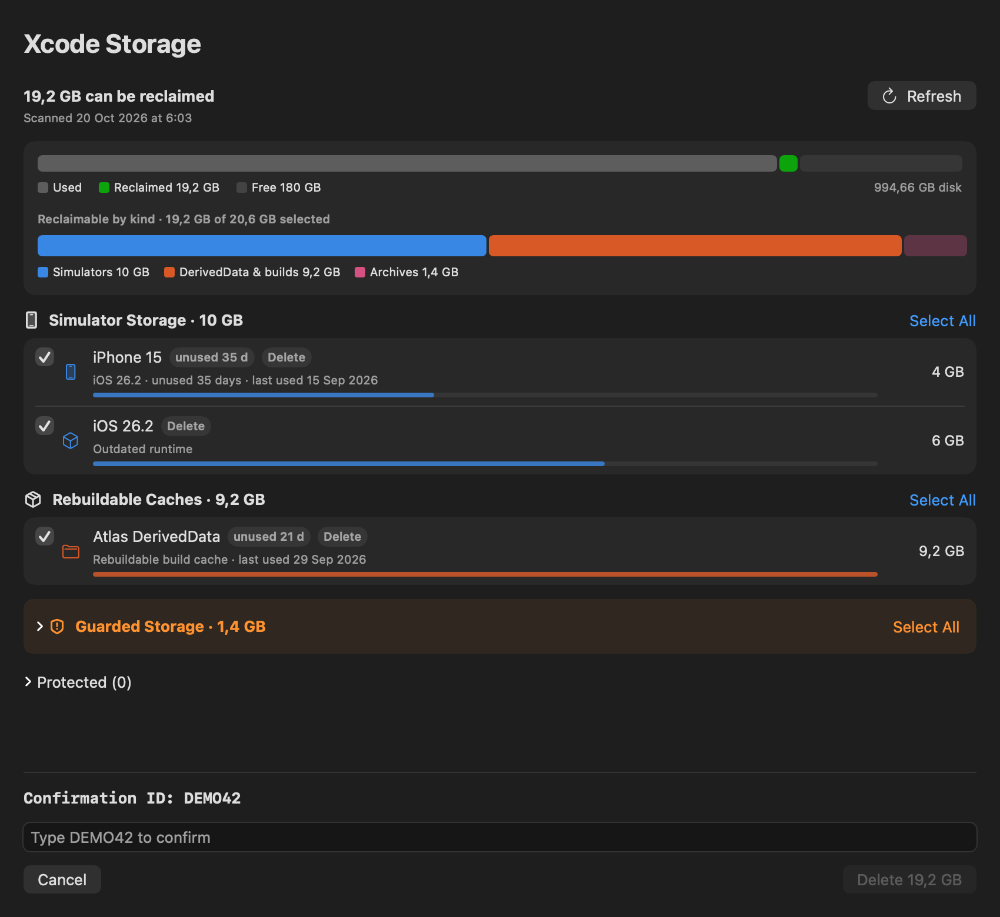

# SimLease

See which project is using each iOS Simulator, what is waiting, and how much
CPU and memory headroom your Mac has. SimLease coordinates simulator work
across coding agents and terminal sessions through managed execution lanes.



Screenshots are rendered from the app's SwiftUI views with sample projects and
data. They do not show live jobs or personal files.

[Install](#install) · [Quickstart](#quickstart) · [Inside the app](#inside-the-app) ·
[Agent workflow](#agent-workflow) · [Update](#update) · [Uninstall](#uninstall)

- **See ownership.** Project colors connect running jobs to their simulators.
  The queue shows who is waiting and why.
- **Limit concurrency.** Start with one lane, or allow up to three. Extra lanes
  open only when the Mac has enough resource headroom.
- **Clean up after jobs.** By default, devices booted for a job shut down when
  it ends. Devices that were already booted are borrowed and stay running.
- **Review crashes and storage.** Repeated app crashes block retries on owned
  targets. Storage cleanup shows what can be reclaimed and requires an explicit
  selection and confirmation.

## Requirements

- An Apple Silicon Mac running macOS 15 or later.
- Xcode, including an installed iOS Simulator runtime. Open Xcode once to finish
  its setup before starting simulator work.

## Install

1. Run this in Terminal:

   ```sh
   curl -fsSL \
     https://raw.githubusercontent.com/jdelaire/SimLease/main/scripts/install-release.sh \
     | zsh
   ```

   This installs the latest stable [GitHub release](https://github.com/jdelaire/SimLease/releases/latest),
   including the menu-bar app, CLI, command shims, updater and login LaunchAgent.
   The app starts automatically and launches again at login.

2. Open a new login terminal and restart any coding agents or GUI tools that
   were already running. They need to inherit the updated `PATH` so normal
   `xcrun`, `xcodebuild`, `axe` and `agent-device` calls reach the shims.

3. Verify the installation in the new terminal:

   ```sh
   simlease --version
   command -v xcrun
   simlease doctor
   ```

   `command -v xcrun` should point to
   `~/.local/lib/simlease/shims/xcrun`, expanded to your home directory.
   `doctor` reports shim coverage and known native device helpers.

The installer downloads the latest stable GitHub release and verifies its
SHA-256 checksum, arm64 architecture, Developer ID signature, and Gatekeeper
assessment before changing the current installation. Activation is staged and
restores the previous version if it fails. During an update, it stops the
running menu app and bootstraps a fresh LaunchAgent registration so the new
signed binary is actually running. It never uses `sudo`.

Click the SimLease icon in the macOS menu bar to open the popover. It is a
menu-bar app, so it does not have a Dock icon. If you need to open it again:

```sh
open "$HOME/Applications/SimLease.app"
```

### Installation troubleshooting

| Symptom | What to check |
| --- | --- |
| `simlease: command not found` | Open a new login terminal. You can also run `~/.local/lib/simlease/simlease doctor` directly to check the installed CLI. |
| `xcrun` still resolves to `/usr/bin/xcrun` | Restart the terminal or agent. The installer adds `~/.local/lib/simlease/shims` at the front of `PATH` in `~/.zprofile`. |
| The menu icon is missing | Open `~/Applications/SimLease.app` and check whether your menu-bar manager has hidden its icon. |
| Device tools cannot find an iOS runtime | Finish Xcode setup and install the runtime you need from Xcode Settings. |

## Quickstart

List available devices and choose a dedicated simulator UUID for your project:

```sh
xcrun simctl list devices available
```

Replace `YOUR-DEVICE-UUID`, the project and the scheme below with your values.
Run the complete job inside one reservation, and use that same UUID in the
command it launches:

```sh
SIMULATOR_ID="YOUR-DEVICE-UUID"

simlease run --device "$SIMULATOR_ID" -- \
  xcodebuild test \
  -project MyApp.xcodeproj \
  -scheme MyApp \
  -destination "platform=iOS Simulator,id=$SIMULATOR_ID"
```

SimLease waits for a lane, runs the command, and cleans up devices it owned
before releasing the reservation. To run a script that builds, launches and
captures an app, put the whole script inside `simlease run` and target the
declared UUID throughout it.

Inspect current reservations and waiting work:

```sh
simlease status --devices
```

For interactive work through Xcode or a T3/MCP Device panel, use a
[native session](#shell-and-native-tool-coverage). Keep that session open across
all device interactions and bind the dedicated helpers reported by `doctor`.
A standalone shimmed `simctl boot` is a complete job, so a device it boots is
shut down when that command ends.

## Inside the app

### Menu and simulator ownership

The popover at the top of this page connects each running lane to its project
and simulator. Click a phone card for its UUID, reservation owner and waiting
work. A lane badge identifies the reservation; a flame marks a warm device;
a warning marks a crash block. The header shows memory and CPU headroom.

One lane is enabled by default. To allow a second independent job when resource
headroom permits:

```sh
simlease config --max-lanes 2
```

Projects must declare their device UUIDs to use separate lanes. Jobs sharing a
device or workspace still wait for one another. See the
[agent workflow](#agent-workflow) for admission and cleanup rules.

### Dashboard

Click the chart icon in the popover footer to open the dashboard. It shows
lane usage over time, queue waits, memory and CPU headroom, attributed crashes,
and typical job durations by project. Choose a time range to inspect recent
activity. Resource charts fill in as the menu app collects samples.



### Storage cleanup

Click **Storage Cleanup…** in the popover footer to review unused simulators,
outdated runtimes and rebuildable Xcode caches. Select the items to remove,
review the total, and type the displayed confirmation ID before applying.
Guarded items such as archives start unchecked and move to Trash when selected.
Cleanup never runs automatically.



See [Xcode storage cleanup](#xcode-storage-cleanup) for eligibility rules and
the CLI workflow.

## Agent workflow

Run each complete simulator job inside one scope:

```sh
simlease run --device DEVICE-UUID -- /path/to/verification-script
```

The command can be an absolute executable, a PATH command, or a shell script.
Repeat `--device` for a phone and watch pair. The reservation stays held until
the command and its cleanup finish.

A device that was shut down when the scope started belongs to that scope.
After success, failure, or cancellation, SimLease stops the owned child process
group, shuts down those devices, and verifies `Shutdown` before admitting the
next job. Prebooted devices are borrowed and remain running. Use
`--keep-running` to explicitly retain a device started by the job.

Exact UUID destinations are inferred for protected `xcodebuild` commands.
Managed test commands disable parallel simulator cloning. Named destinations
and simulator launches hidden inside arbitrary scripts cannot establish device
ownership; declare every intended UUID on the outer scope. Nested commands
inherit a validated task token instead of acquiring another lane.

Allow more than one simulator job at a time:

```sh
simlease config --max-lanes 2
simlease config
```

The default is one lane. With more lanes, a job that declares device UUIDs
takes per-device locks and a lock on its DerivedData, project or working
directory, then the first free lane. Lanes after the first open only while
the Mac has headroom: memory at least 45% free (closing below 40%), CPU idle
smoothed over about three minutes at least 30% (closing below 20%), and
modest compressor and swap growth measured over 30 seconds, one minute after
the last shortfall and 90 seconds after the last admission. Load average is shown
but does not gate lanes, because on macOS it counts threads waiting on disk and
stays high while the CPU is largely idle. Running jobs are never stopped when headroom drops. Jobs without
declared UUIDs, simulator commands without a UUID target, and device
shutdown, repair, recovery and cleanup take every lane. Native sessions and
`hold` use the first lane. A queued exclusive job stops new single-lane
admissions until it runs. With several lanes, nested simulator commands must
name their UUID. An unfinished job record keeps its devices reserved until
recovery.

Inspect coordination and command coverage:

```sh
simlease status --json --audit
simlease status --devices
simlease doctor --json
```

`--devices` adds booted and reserved simulators with their reservation:
`owned` devices were booted for the current job, `borrowed` devices were
already running and stay up, `warm` devices are kept booted by SimLease
between jobs, and `unreserved` devices are booted outside any SimLease
reservation. The menu popover lists the same simulators with the lease owner,
queued threads that declared the device, and unmanaged processes targeting it.
The menu queries the simulator inventory only while the popover is open.

For booted simulators, `--devices` also reports memory, CPU and process count.
Memory is the summed `phys_footprint` of every process under the device's
`launchd_sim`, the figure Activity Monitor shows. CPU is measured against the
previous status sample when it is under 30 seconds old, otherwise over a
500 ms window, and can exceed 100% on multicore Macs. The menu shows the same
figures on each phone card. Values that cannot be read are left out rather
than shown as zero. To see which processes use the most memory in one booted
simulator:

```sh
simlease measure --device DEVICE-UUID
simlease measure --device DEVICE-UUID --limit 30 --json
```

With `--devices`, status also compares each installed iOS simulator runtime
with the selected Xcode's simulator SDK. A runtime with the same iOS version
but an older build than the SDK is reported in `staleRuntimes`, flagged on its
devices, and shown as a menu alert, because apps built against the newer SDK
can call system symbols the older runtime does not provide. On this Mac an
iOS 27.2 runtime build 24B5089g under an SDK build 24B5109a crashed apps in
`Date` comparisons by jumping to address 0. `simlease run` and `session begin`
print the same warning for declared devices on a stale runtime. Install the
matching runtime with `xcodebuild -downloadPlatform iOS`.

The menu bar shows one block per lane in the running project's color, a
dashed block when headroom keeps an extra lane closed, a progress ring for a
single lane, and a warning triangle when a simulator is crash-blocked. The
popover shows headroom rings, lane bars that fill toward each project's
typical duration, queued jobs with the reason they wait, and a grid of
simulators. The dashboard window, opened from the popover footer, charts lane
use, memory and CPU headroom, crashes per simulator and per-project timing.
Its data comes from:

```sh
simlease history --json --hours 24
```

Finished jobs record their lane and queue wait, and `status` records one
headroom sample per minute, keeping 24 hours.

`status --json` also reports `typicalDurations`, the median lane hold time of
the last 20 jobs per project once a project has 3 finished jobs, and
`nativeIdleSince` for a native session, the later of its start and its last
admitted native command. The menu shows the owner's typical duration, a
"starts in ≈ N min" estimate for each waiter assuming arrival order, and a
warning when a native session has admitted no device command for 10 minutes.
Estimates stop at the first waiter whose project has no history. Lane
admission is not strictly first come, first served, and the idle warning
never ends a session.

Opt into a warm device pool for terminal commands that enforce complete guest
settlement before exiting:

```sh
simlease run --keep-warm --device DEVICE-UUID -- /path/to/settled-job
```

`--keep-warm` permits reuse or automatic shutdown of devices the job owns.
Before exiting, the command must finish or stop every background task, external
request, capture stream and custom simulator job it started, and remove any
registration that could restart custom work. SimLease terminates ordinary apps
but cannot verify this guest settlement. Exit status 0 alone does not prove it.
Use the flag only when the command enforces that contract. Default jobs keep
their shutdown boundary. Native sessions always require explicit settlement
and keep their previous shutdown behavior.

After an opted-in job exits 0 without cancellation, cleanup errors, crash blocks
or pairing, SimLease terminates ordinary apps and retains its owned device.
The next job declaring that UUID owns it again without a cold boot. Failed,
cancelled, crash-blocked and recovered jobs shut it down. `--keep-running`
retains devices outside the pool and cannot be combined with `--keep-warm`.
Warm devices become eligible for shutdown after 10 idle minutes, with a
best-effort limit of 2 warm devices. Reaping runs at job start and finish and
every minute from the menu when the lane is free, with the same refusal checks
as `simlease device shutdown`. Devices in use or declared by queued jobs stay
up until a later pass. Run it by hand with `simlease device reap`.

A command that erases, deletes, clones or boots a claimed warm device gets that
device shut down first. Nested and bound native `simctl boot` calls on a claimed
warm device succeed without booting again. Declared UUIDs and normal admission
checks still apply.

Shut down booted simulators you know are unused:

```sh
simlease device shutdown --device UUID [--device UUID ...]
```

Shutdown takes the simulator lane like any job, so it waits for the current
job and blocks new work until it finishes. After acquiring the lane it refuses
devices that are paired, declared by a queued job, or targeted by a visible
simulator process, and refuses every device while a simulator process has an
unknown target. It never erases or deletes devices. The process audit cannot
see Simulator windows or idle device tools, so only name devices nothing is
using. An interrupted or unverified shutdown reports `unresolved`, exits 75,
stops the batch, and blocks new work until a later run names that device again
and verifies its state. The menu offers the same action on
unreserved booted rows after an inline confirmation that lists each UUID.

`status` reports `free`, `leased`, or `metadataError`. An unfinished cleanup
appears as an error and blocks new protected work. After a process crash,
recovery runs before the next protected job, or can be requested directly:

```sh
simlease recover
```

Recovery requires proven process ownership. A live or unverifiable owner is
never taken over. Failed cleanup retains its journal for a later retry; there
is no force-release command.

### Shell and native tool coverage

Normal `xcodebuild`, `xcrun`, `axe`, and `agent-device` lookup goes through
installed PATH shims. Nested `xcrun xcodebuild` is protected too. Absolute
executables must be placed inside `simlease run`; PATH cannot intercept them.
An inherited `SIMLEASE_HELD=1` flag alone never authorizes bypass.

For Xcode GUI or native T3/MCP device work, start a foreground native session
before opening or booting the device:

```sh
simlease session begin --device DEVICE-UUID \
  --title "UI verification" --project "Project"
```

Repeat `--device` for every target. Keep this command running. Wait for its
`state: "ready"` JSON before using the native tool, and retain the returned
`sessionID`. A queued session does not print readiness until it owns the lane
and its durable process journal is ready.

Stock Nightly's device hub can inherit SimLease shims. Bind its dedicated
helper process before using MCP so internal `xcrun simctl` calls participate in
the reservation without trying to acquire the lane again:

```sh
simlease session begin --device DEVICE-UUID \
  --client-pid HUB-PID --client-pid DAEMON-PID \
  --title "Native UI verification" --project "Project"
```

Use the live hub PID from `~/.t3/userdata/device/agent-device/hub.json` and,
when running, the dedicated agent-device PID from the adjacent `daemon.json`.
Read only their `pid` fields. All helpers needed for interactive commands must be running and bound before
those commands begin. If a helper starts or restarts after readiness, stop
interactive work and reestablish a session with its current identity. Repeat
`--client-pid` for each trusted, dedicated helper. Never bind a broad T3
server, login shell, or shared process that can launch unrelated work. Binding
covers every request handled by that helper, not just this thread. Other
threads must acquire their own reservation before sending requests.

SimLease captures each PID's kernel start time before waiting for the lane
and rechecks it before readiness. Bound helpers may use inventory queries and
supported `simctl` actions with the declared UUID in the actual target
position. Known leading options for `launch`, `spawn`, `pbcopy`, and `pbpaste`
are accepted, including separate option values such as `launch --stdout /tmp/app.log UUID bundle`.
Unknown options before the device are rejected. Device inference for shimmed
and standalone jobs uses the same target position for supported actions, so
UUIDs in option values or application arguments do not count as device targets.
Runner `xcodebuild` calls require every destination to contain a
declared simulator UUID. Named targets, `booted`, `all`, alternate device sets,
host-wide actions and unresolved build destinations fail immediately. Use a separate managed
scope for those operations. Absolute paths still require the native session;
PID binding only controls calls that reach installed shims.

Use the exact absolute `agent-device` launcher and all device/config/session
flags returned by `device_open` for interactive commands. Keep the native
session open across every press, tap, screenshot, runner build and stream.
A bare PATH `agent-device` or mutating `xcrun` from another shell is outside
the owner process tree and still waits; do not wrap the external client in another
`simlease run` while holding the native session. `simlease doctor` identifies
known dedicated helpers and prints the supported begin/finish recipe.

For the observed agent-device 0.21.25 runner crash in modal inspection, see
[the verified coordinate interaction workaround](docs/troubleshooting/2026-10-19-agent-device-runner-crash.md).

Read-only `simctl` queries, including device lists, pass through SimLease
without taking the exclusive lane. Their results are observations and do not
establish ownership. Mutating standalone shim calls remain complete managed jobs. A standalone boot
therefore ends with owned-device cleanup. Use a native session for interactive
work that must stay booted between commands. Devices already booted when the
session starts are borrowed and remain running after settlement. Close native
runner sessions and streams before finishing; a live admitted runner keeps
settlement waiting until it exits.

Finish blocks new bound shim requests and waits for existing admitted wrappers
before writing settlement. This does not prove that an external daemon or a
child surviving a killed wrapper has finished. Confirm external settlement
explicitly.

After all native commands, daemon requests, background work, and capture streams
have finished, settle that exact session from another terminal:

```sh
simlease session finish SESSION-ID --settled
```

`--settled` is your attestation that external work has finished. Finish waits
for owned-device shutdown and cleanup; an acknowledgment alone is not success.
Prebooted devices remain running. In T3, `device_close` with `shutdown: false`
only removes panel bookkeeping and does not prove that device work or capture
streams have stopped. Close the device with `shutdown: true` when the session
owns it, and wait for outstanding operations and streams to finish before
settlement. Do not shut down a borrowed device to finish a session; stop its
session work and streams through the native tool instead.

If cancellation leaves external work uncertain, do not pass `--settled`.
An interrupted or killed keeper leaves an unresolved journal. Recovery and new
jobs remain blocked without shutting down owned devices. Once external work
is confirmed finished, run `session finish` with the original ID to acknowledge
it and recover. Failed shutdown remains quarantined; retry after fixing the
cleanup failure. Session IDs and acknowledgment tokens cannot settle a newer
session.

This workflow uses stock T3 Nightly. It does not install a native T3 hook or
modify the signed app. Every native launch still needs an explicit session.
`simlease hold` remains available for manual terminal reservations; native
external work should use the settlement-aware session commands above.

`doctor` and `status --json --audit` inspect known running tool processes.
The menu app repeats this audit every five seconds and displays a warning for
unmanaged work, unverified native targets, or incomplete inspection. A matching
UUID inside a native reservation is labeled unverified because a process
snapshot cannot prove external ownership. Idle daemons, inventory queries, and
explicit Android, physical-device, or macOS targets are excluded. Audit output
contains tool names, process identities and device UUIDs, never raw command
arguments or environment values.

The audit is advisory. Snapshots can miss brief commands and cannot prove that
persistent daemons or capture helpers are idle. It does not prevent a native
application from bypassing coordination. GUI applications already running must
be restarted or configured explicitly to inherit the installed PATH.
Persistent `agent-device daemon` startup is not wrapped in a lifetime-long
lease.

Managed `agent-device` clients and daemon starts receive a PATH with SimLease
shims removed for internal tool lookup, preventing recursive lease acquisition.
Restart a daemon previously started with a shimmed PATH when its current work
finishes. Native launchers must configure the same internal tool lookup.
Daemon requests may outlive a canceled client; client exit cannot establish
external settlement.

Name the current Codex thread or Claude Code session so the menu bar and
waiters can identify it:

```sh
simlease name "[Project] Simulator validation"
```

SimLease reads the thread from `CODEX_THREAD_ID`, then `CLAUDE_CODE_SESSION_ID`.
To name a single job, or a job from a shell with neither variable, pass
`--title` to `simlease run` or set `SIMLEASE_THREAD_TITLE`:

```sh
simlease run --title "Onboarding UI tests" --device DEVICE-UUID -- /path/to/job
```

The order is `--title`, then `SIMLEASE_THREAD_TITLE`, then the registered name.
The menu bar shows the title on the lane bar, in the running row and on the
leased simulator tile. A leading `[Project]` that matches the job's project is
dropped there, because the color chip already shows the project.

## Automatic simulator recovery

Managed jobs, `status`, and `doctor` inspect simulator crash reports. The menu
checks through `status` every five seconds. One verified runtime-service crash
from PosterBoard or SpringBoard blocks further managed work on that device,
including when it was borrowed or no owned job scope was recorded. Attribution
requires the simulator's coalition UUID and a `launchd_sim` parent, plus the
expected Apple bundle ID and executable path. An installed app with the same
name does not receive this classification.

Ordinary app and test-runner crashes still require two matching incidents from
the same executable build within 120 seconds and an owned scope. Matching uses
crash event and launch times, not the report file's modification time. History
spans jobs and ignores duplicate incidents. Device quarantine does not grant
ownership. SimLease stops only its current owned terminal child group when a
newly received eligible crash belongs to that scope, then runs normal cleanup.
Borrowed devices, preexisting system processes, and `--keep-running` devices
are not automatically interrupted. Unowned quarantine does not accelerate warm
device shutdown. Normal idle and capacity cleanup still applies.

Critical-service failures queue automatic nondestructive recovery. The menu runs
one maintenance worker each minute; blocked CLI admission also tries maintenance
when the menu is closed. `simlease device maintain` runs the same worker.
Recovery waits for exclusive lanes, settled tasks and native helpers, complete
process/crash audits, host headroom, and an available, Shutdown, unpaired device.
Booted devices are protected. Normal owned cleanup and warm expiry can shut them
down first. Missing devices move to history only after successful full inventory.

Each attempt boots the same UUID, requires positive stable SpringBoard PIDs and
PosterBoard PIDs when relevant, observes 120 booted seconds without a new critical
report, then verifies shutdown and scans again. Missing services, report backlog,
unreadable evidence or changed identity prevent success. This establishes observed
restart stability, not a repair of Apple's underlying bug or proof of wallpaper
functionality. No wallpaper data is erased or modified. No automatic device
replacement occurs. Recovery resolves only the exact verified infrastructure
reason. Independent app failures and acknowledgment timestamps remain intact.

Attempts persist across processes: at most two per device in 24 hours, at least
ten minutes apart. Cooldown holds no lanes. Uncertain commands preserve the
existing recovery journal and require verified settlement before any more work.
Known runtime AppIntentsLiveEntityService and intelligencetasksd failures remain
grouped diagnostics; they do not block or cancel app jobs. Classification requires
exact Apple identity and executable suffix. Other unknown failures stay conservative.
Legacy reports are reread in bounded batches to enrich classifications.
Classification proof lives in a separate bounded file that older CLI writers
cannot strip. Previously consumed reports use a classification-only migration:
only retained immutable incident identities are enriched, without replaying
removed incidents, changing acknowledgments or generating cancellations.
Missing raw evidence remains unclassified.

Native sessions warn and reject new unsafe shimmed calls after a crash block.
Queries, termination, shutdown and explicit settlement remain available. They
never kill a shared daemon or attest settlement. Calls sent directly to an
already-running native daemon cannot be intercepted by PATH; stop submitting
requests when the session reports a crash block and settle all external work.
Crash reports may arrive late, so this cannot guarantee immediate prevention
of every crash dialog. SimLease does not disable macOS crash reporting.

The menu, `status --json`, and `doctor` show crash blocks. Evidence is bounded
to the latest 256 owned scopes and 512 incidents. Active jobs inspect at most
once per second. Each scan reads at most 64 changed reports, each at most 5 MB,
with a 16 MB scan budget. Scan progress survives CLI restarts and advances only
after ingestion succeeds, including for positively unrelated host reports.
Malformed or unattributable reports stay pending and prevent recovery verification.
Simulator reports with an exited parent can finish ingestion as unknown incidents
when platform, coalition, Apple identity and mounted executable agree. This does
not establish critical-service provenance or clear existing blocks.
The system CoreSimulator `dtdeviceinfod` executable is also accepted at its exact
iOS or watchOS framework location, and `dtpasteboardd` at its exact iOS location,
when platform and executable-image proof agree. Both retain the same unknown
classification and owned-crash protection.
Unchanged consumed reports do not rewrite crash history. Unreadable files wait
30 seconds before another
attempt, so they cannot continuously hide older reports. Future-dated events
remain pending until their event time. Directory enumeration still scales with
the number of report files. Missing or unreadable reports limit detection.

Owned-job cancellation receipts use a separate bounded file so older CLI
processes cannot erase them while rewriting history. Already-running processes
retain their earlier watchdog and cleanup behavior until they finish.

This contains failures and attempts a bounded restart automatically. It cannot
fix Apple's runtime code or guarantee that no crash dialog will appear.
Requests already running in detached native daemons remain outside shim
enforcement and must be stopped and settled through their owning session.

Create a fresh device that SimLease may replace if its boot health later fails:

```sh
simlease device create --name "Disposable UI tests" \
  --type com.apple.CoreSimulator.SimDeviceType.iPhone-18-Pro \
  --runtime com.apple.CoreSimulator.SimRuntime.iOS-27-2 --disposable
```

Use the returned `deviceID` as the explicit target for later managed jobs.
Existing devices are never silently enrolled as disposable.

After work has finished and the device is Shutdown:

```sh
simlease device repair --device DEVICE-UUID
```

Repair owns the lane, checks boot completion, shuts down and retries boot once
after an infrastructure failure. It refuses live, unavailable or paired
targets. If both attempts fail, only an unchanged registered disposable device
can be replaced. The replacement retains the runtime and device type and must
boot successfully and be Shutdown before the original is deleted. Replacement
starts with fresh data. JSON returns `state: "replaced"`, the new `deviceID`
and `replacedDeviceID`. Update the next job's target explicitly; SimLease does
not rewrite commands or T3 sessions. Persistent devices are never deleted.

App crashes alone do not trigger replacement. A healthy repair preserves app
crash blocks unless the caller explicitly allows another attempt after
investigating the cause:

```sh
simlease device repair --device DEVICE-UUID --acknowledge-crashes
```

When the cause is fixed elsewhere, such as a runtime update, clear the block
without booting the device or waiting for a lane:

```sh
simlease device acknowledge --device DEVICE-UUID
```

The crash history is kept, and new repeated crashes block the device again.
The menu alert offers the same action as Allow retries.

This retains incident history. It does not claim that the app crash is fixed.
Device recovery cannot nest inside a managed job or bound native client.

Interrupted or uncertain recovery operations retain a transaction and block
new jobs, cleanup and ordinary `recover`. Confirm that the previous recovery
commands and their background work have finished before resuming:

```sh
simlease device repair --device ORIGINAL-UUID --settled
```

To abandon a recovery while preserving its devices, use
`simlease device recover --settled`. Every recorded existing device must be
Shutdown. The command blocks those targets pending inspection and never deletes
them. An unregistered orphan from an interrupted creation is also preserved.
Never use `--settled` after uncertain cancellation. Recovery never deletes a
device whose identity was not recorded and verified. Jobs already running at
installation keep their earlier implementation; wait for those jobs to finish
before using the new recovery commands.

## Slim simulator profiles

A stock iOS simulator runs around 180 background services such as Siri,
Spotlight indexing, photo analysis, widgets and iCloud sync. A slim profile
disables those launchd services inside one simulator so it uses less memory,
which leaves more headroom for extra lanes. The service catalog comes from
[simslim](https://github.com/MobAI-App/simslim); its README measured 4.0 GB
stock and 0.9 GB slim for one device. Run `simlease measure` before and after
to see the effect on your own projects.

List the categories, what each one breaks, and its approximate saving:

```sh
simlease device slim --list
```

Slim a shut-down simulator, keeping the categories its tests need:

```sh
simlease device slim --device DEVICE-UUID --keep health,photos
simlease device unslim --device DEVICE-UUID
```

Slimming disables every category you do not keep, including widgets and
wallpaper posters (PosterBoard), Siri, Spotlight, iCloud, StoreKit and push
connectivity. SpringBoard and the services simslim lists as required always
stay enabled. Profiles need an iOS 18.5 or newer runtime, because older
runtimes forget launchd overrides at reboot. The device must be available,
unpaired and shut down, and `slim` refuses crash-blocked devices; `unslim` is
allowed on them and keeps the block.

The command takes every lane, boots the device, changes only the services
whose state differs, reboots to verify the overrides persisted, and shuts the
device down again. While it runs, `device-recovery.json` holds new simulator
work. If it is interrupted, confirm no device work remains and rerun the same
command with `--settled`. A failed change leaves the device shut down and its
profile marked incomplete until `slim` or `unslim` succeeds.

`status --devices` and the menu mark slim devices. `doctor` reports profiles
whose booted device has drifted from the recorded profile, profiles left
incomplete, and profiles whose device no longer exists, for example after a
repair replaced it.

## Xcode storage cleanup

Review without deleting:

```sh
simlease clean plan
simlease clean plan --json
```

Apply only selected targets from the exact reviewed plan:

```sh
simlease clean apply ABC123 \
  --target 'derivedData:/path/from-plan' \
  --target 'DEVICE-UUID'
```

A device is eligible only when shut down and reported unused for at least 30
days. Booted devices, devices with unknown age, and devices whose data path
does not exactly match their UUID are protected. A runtime is eligible only
when Apple's dry run identifies its exact image and no booted device uses it.

Rebuildable cache thresholds are:

- temporary/custom DerivedData: 24 hours;
- Xcode previews: 7 days;
- standard DerivedData and project `.build`: 14 days.

Each shut-down simulator with at least 10 MB of caches, logs and temporary
files also appears as a rebuildable `device-data:UUID` target. It covers every
`Caches` and `tmp` directory in the device's data folder plus `Library/Logs`,
`var/log`, `var/db/diagnostics` and `var/db/uuidtext`. App bundles,
`Documents`, `Mobile Documents`, `Media` and `MobileAsset` are never searched.
Applying it empties those directories but keeps them, removes symlinks without
following them, and refuses a directory reached through a symlink. It takes
the simulator lease, and is skipped if the device booted or its files changed
since review. Apps rebuild caches on demand; old simulator logs are gone for
good. SimLease reads crash reports from the Mac, not from these logs.

Result bundles older than 30 days, Archives older than 90 days, and every
Device Support folder appear as guarded storage. They are never preselected
and move to Trash instead of being permanently deleted. SimLease never empties
Trash.

Plans expire after ten minutes and can be used once. Apply requires one or
more `--target` flags, rechecks fingerprints and active build paths, and skips
anything changed or newly protected. A leased simulator lane defers simulator
inventory without blocking filesystem review. Cleanup never force-releases a
lease, stops tests, deletes worktrees, or runs automatically.

## Update

```sh
simlease update
```

Updates are manual. The command uses the installed verified release bootstrap,
never downgrades, and exits successfully when already current.

## Managed paths

```text
~/Applications/SimLease.app
~/Library/LaunchAgents/com.jdelaire.simlease.plist
~/.local/lib/simlease/simlease
~/.local/lib/simlease/install-release.sh
~/.local/lib/simlease/shims/
```

The shims delegate to the next matching command on PATH, so an existing custom
AXe remains the underlying AXe.

## Uninstall

From a source checkout:

```sh
scripts/uninstall.sh
```

Uninstall removes only SimLease-managed app, agent, CLI, updater, shims, and
marked PATH block. It preserves simulator data, SimLease cache metadata, and
the underlying custom AXe.

## Development

```sh
swift test
scripts/package-app.sh
zsh Tests/InstallationTests/install-app.zsh
zsh Tests/InstallationTests/install-relaunch.zsh
zsh Tests/InstallationTests/install-release.zsh
zsh Tests/InstallationTests/package-release.zsh
```

Local packaging is ad-hoc signed. Public tag releases are Developer ID signed,
notarized, stapled, and published with a matching SHA-256 file.

## License

SimLease is available under the [MIT License](LICENSE).
